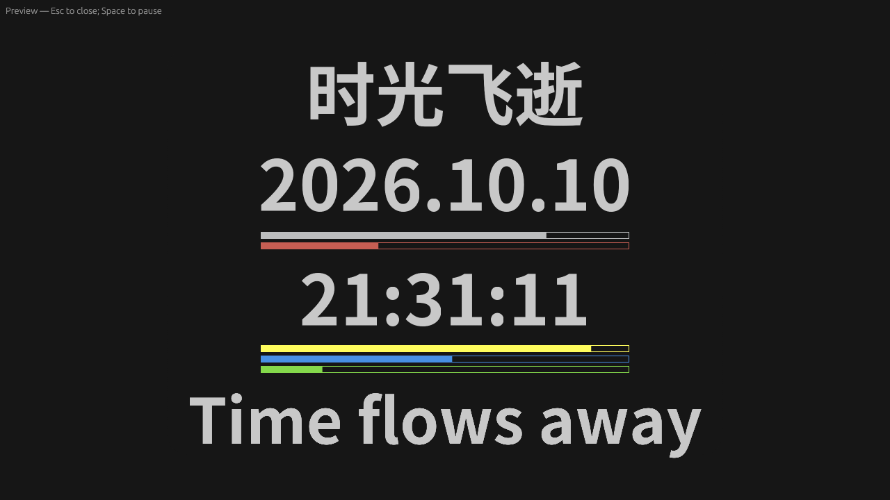

# Time Flows Away

[](https://github.com/trybonk/time-flows-away/actions/workflows/native-windows.yml)
[](LICENSE)

A minimal clock wallpaper for **Windows 11**, written in Rust. Watch the time,
date, and five colored progress bars for the passing year, month, day, hour,
and minute, right on your desktop.

Runs behind desktop icons as a standalone native application, with an English
settings window and tray controls.



*Preview captured from the native app's Linux development build. Windows uses
its installed system fonts.*

## Features

- **Clock and calendar** — custom date/time formats, 12/24-hour time, optional
  weekday, and progress through the year, month, day, hour, and minute.
- **Your text and style** — custom heading/footer, color emoji, fonts, text sizes,
  colors, bar dimensions, alignment, and offsets.
- **Backgrounds** — solid colors or PNG/JPEG images loaded in the background, with a configurable panel
  color and opacity.
- **Countdown and elapsed time** — track a future date or time since a past event,
  in days, detailed time, or seconds.
- **Quality and animation** — antialiased text and color emoji, smooth bars at 30 FPS by default,
  optional 60 FPS, or animation off for lower resource use.
- **Live settings preview** — see edits before applying them; Save / Ctrl+S
  updates the running wallpaper within two seconds.
- **Desktop controls** — tray Settings, Pause / Resume, and Quit; opt-in startup
  at Windows sign-in and protection against duplicate launches.
- **Recovery** — follows primary display and DPI changes, and restarts the
  renderer after Explorer recreates the desktop.

## Download and run

**Requirements:** Windows 11 x64, **24H2 or newer**. The wallpaper currently runs
on the **primary display**. This project is in active development; see the
[validation results](docs/VALIDATION.md).

1. Open [Windows build](https://github.com/trybonk/time-flows-away/actions/workflows/native-windows.yml)
   and select a successful run for `feat/settings-and-tray`, the current
   development branch.
2. Download the **time-flows-away-windows-x64** artifact and extract the ZIP.
   GitHub requires you to sign in to download workflow artifacts.
3. Run **time-flows-away-native.exe**. Administrator rights are not required.

Right-click the tray clock for **Settings**, **Pause / Resume**, or **Quit**.
Double-click the tray icon to open settings; it may be in the hidden-icons menu.
Quitting also closes the settings window.

Enable **Settings → System → Start with Windows** for sign-in startup. This
switch applies immediately. Keep the EXE at the registered location; after moving
it, update the location in settings.

## Settings and shortcuts

Settings use an explicit **Save** / **Ctrl+S**. Closing the window discards unsaved
edits. Saved settings live in `%LOCALAPPDATA%\TimeFlowsAway\config.toml`;
diagnostics are in the same directory's `app.log`.

| Action | Command or shortcut |
|---|---|
| Open settings | Tray **Settings** or `time-flows-away-native.exe --settings` |
| Open a window preview | `time-flows-away-native.exe --preview` |
| Pause / resume the preview | **Space** |
| Close the preview | **Esc** |
| Quit wallpaper without the tray | Hold **Ctrl+Alt+Shift+Q** for at least one second |
| Use another settings file | `time-flows-away-native.exe --config "C:\path\config.toml"` |

OpenGL is the default Windows renderer. Renderer comparisons and advanced
configuration are described in the [development guide](docs/DEVELOPMENT.md).

## Build from source

Install Rust and Visual Studio Build Tools with **Desktop development with C++**
and a Windows SDK. Run from the repository root:

```powershell
cargo build --locked --release
.\target\release\time-flows-away-native.exe
```

The Rust toolchain and dependencies are pinned. GitHub Actions runs formatting,
Clippy, tests, and a Windows release build, then uploads the EXE and documentation.

- [Development and architecture](docs/DEVELOPMENT.md)
- [Windows manual checks](docs/SETTINGS-CHECKLIST.md)
- [Validation results](docs/VALIDATION.md)
- [Original Wallpaper Engine version](legacy/wallpaper-engine/README.md)

## License and credits

Licensed under [Apache-2.0](LICENSE). The native design is based on
[twenty-zhang/time-flows-away](https://github.com/twenty-zhang/time-flows-away).
See [NOTICE](NOTICE) for credits. The original web wallpaper is preserved in
`legacy/wallpaper-engine/` as a reference.
